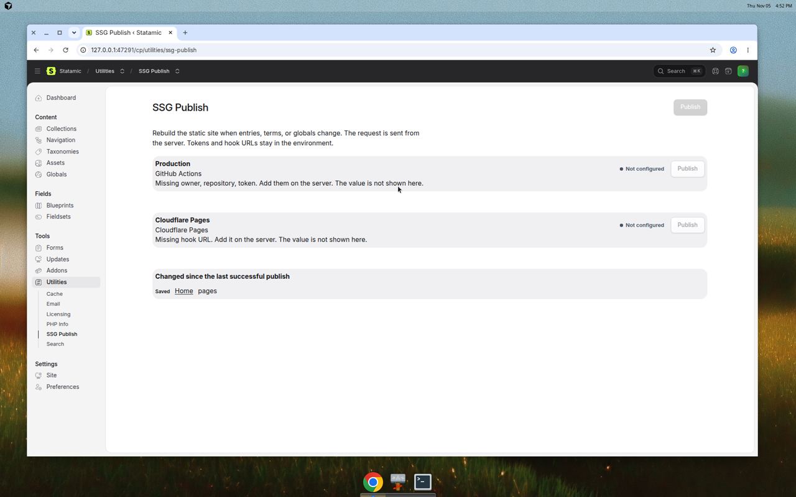
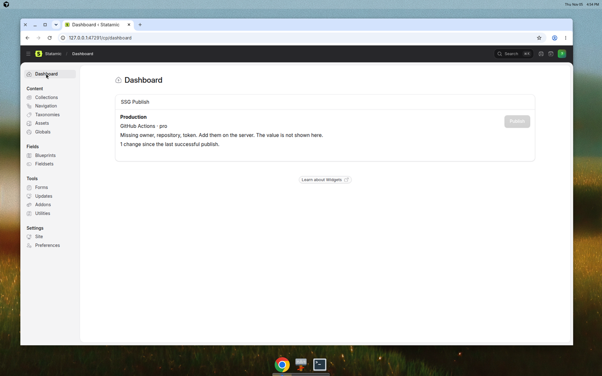
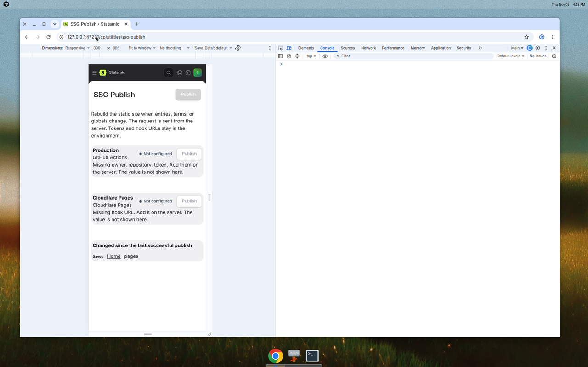
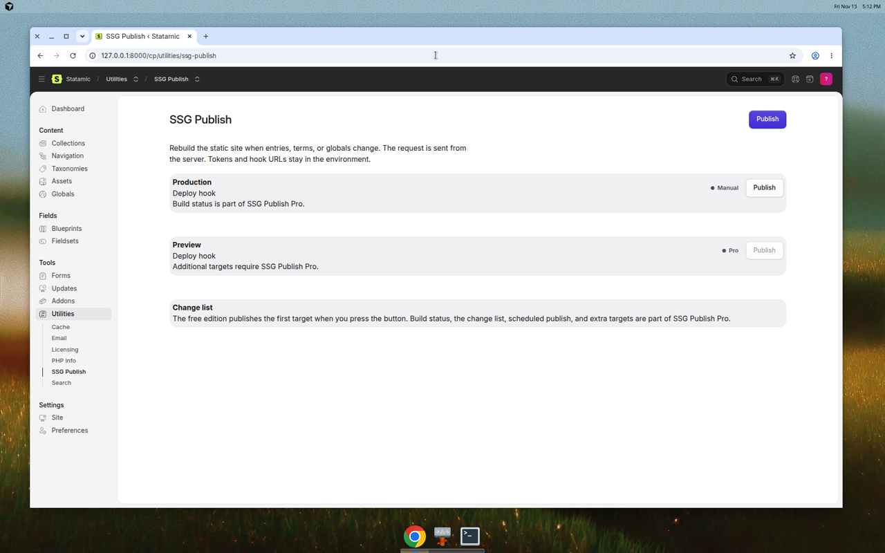
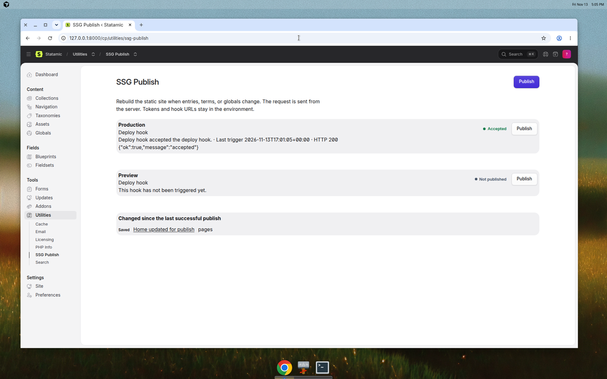
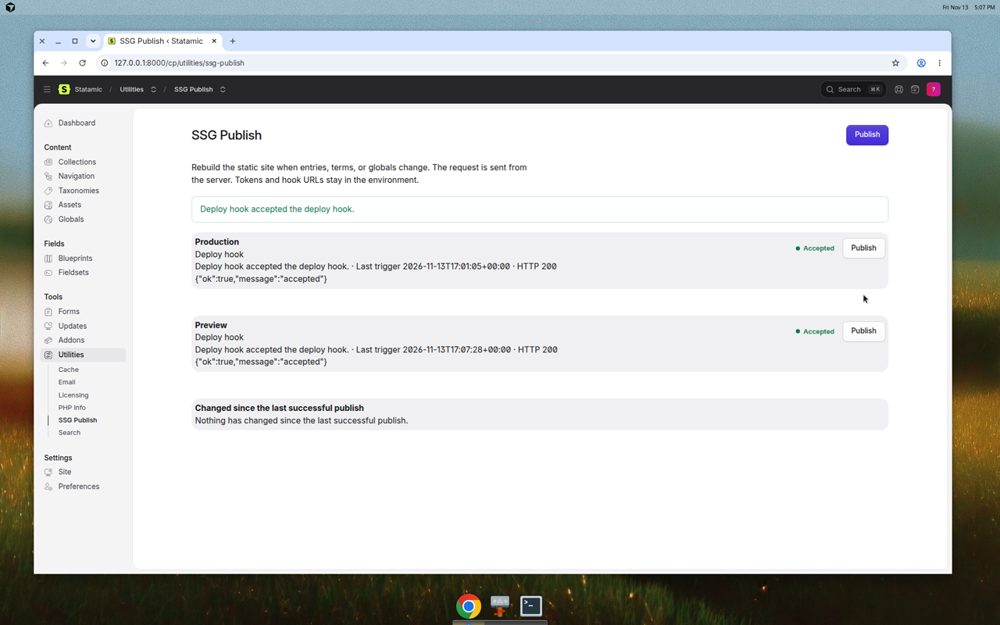

# SSG Publish

A generic HTTPS deploy hook has been published from a real Statamic 6 Control Panel to a real local listener. GitHub Actions, Cloudflare Pages, Netlify, and Vercel have not. Those APIs were not called, because this tree has no credentials for them. A passing test run is not proof that those hosts accept a publish. The exact record is [docs/E2E-REPORT.md](docs/E2E-REPORT.md).

Publish a [statamic/ssg](https://github.com/statamic/ssg) site from the Control Panel. Editors get a Publish button, and on the Pro edition they can see whether the build is queued, running, or finished, what changed since the last successful publish, and let scheduled entries go live without someone running the generator by hand.

This is the gap described in [statamic/ssg#124](https://github.com/statamic/ssg/issues/124). [segment.holdings](https://segment.holdings) is the first site it is built for: a Statamic static site built by GitHub Actions and deployed to Cloudflare Pages.

SSG Publish does not generate HTML inside the Control Panel request. It asks your existing build to run, either by dispatching a GitHub Actions workflow or by POSTing to a host deploy hook.

It does not bypass Statamic Core or Statamic Pro limits. Editions are the addon's own Free and Pro editions, checked with Statamic's addon edition API.

## Requirements

- PHP 8.3 or newer
- Statamic 6.0 or newer
- A build that already runs `php please ssg:generate`, or a host that builds the site when a deploy hook is called

`statamic/ssg` belongs on the site that builds. This addon does not require it in the Control Panel app.

## Install

Packagist versions come from git tags. `composer.json` does not set `version`. After this package is submitted to Packagist, install it with:

```bash
composer require big-city-software/statamic-ssg-publish
```

This repository is not on Packagist yet. `composer require` will fail until the maintainer tags a release and submits the package. The command above is the install path that Packagist will serve.

Statamic publishes the Control Panel assets when the package is installed. If you are installing from a path repository before that, add the path repository and then publish the assets yourself:

```bash
php please vendor:publish --tag=ssg-publish --force
php please vendor:publish --tag=ssg-publish-config
```

The second command copies `config/ssg-publish.php` into the site. Put secrets in the environment, not in the committed config.

## Editions

Editions are declared in `composer.json` under `extra.statamic.editions` and selected in `config/statamic/editions.php`:

```php
'addons' => [
    'big-city-software/statamic-ssg-publish' => 'pro',
],
```

Leave it unset to use the Free edition. Statamic checks the license. This addon only asks `$addon->edition()`.

Free is the manual publish tier: the Publish button and the first target. Pro is $39 and adds build status, the change list, scheduled and debounced auto-publish, and more than one target. This price is the approved commercial model. This repository has not been submitted to Packagist or the Statamic Marketplace.

| | Free | Pro |
| --- | --- | --- |
| Publish button | Yes, first target only | Yes, every enabled target |
| GitHub Actions and deploy hooks | First target | Every target |
| Build status and hook response | No | Yes |
| Change list | No | Yes |
| Scheduled and debounced auto-publish | No | Yes |

A second configured target is shown in the utility and locked on the Free edition. The button does not call it.

## Permission

The utility registers `access ssg_publish utility`. Super users have it. For everyone else, grant it on the role. Users without it do not see the utility, and the dashboard widget tells them they cannot publish.

The publish and status endpoints use that same permission. Requests are rejected on the server.

## Configure a target

```php
'targets' => [
    'production' => [
        'driver' => 'github_actions',
        'label' => 'Production',
        'enabled' => true,
        'owner' => env('SSG_PUBLISH_GITHUB_OWNER'),
        'repo' => env('SSG_PUBLISH_GITHUB_REPO'),
        'workflow' => env('SSG_PUBLISH_GITHUB_WORKFLOW', 'deploy.yml'),
        'ref' => env('SSG_PUBLISH_GITHUB_REF', 'main'),
        'token' => env('SSG_PUBLISH_GITHUB_TOKEN'),
        'inputs' => [],
    ],
],
```

Supported `driver` values:

- `github_actions`
- `cloudflare_pages`
- `netlify`
- `vercel`
- `hook` for any other HTTPS endpoint that accepts POST

`auto_targets` chooses which targets automatic publish hits. `null` means all of the targets the current edition allows. If the GitHub workflow already deploys to Cloudflare Pages, do not also add a Cloudflare deploy hook or the site will build twice.

### GitHub Actions

The workflow has to allow a manual run:

```yaml
name: Deploy

on:
  workflow_dispatch:
  push:
    branches: [main]

jobs:
  deploy:
    runs-on: ubuntu-latest
    steps:
      - uses: actions/checkout@v4
      - name: Build the static site
        run: php please ssg:generate
      # then deploy storage/app/static, or whatever your host expects
```

Create a token that can list and dispatch that workflow. A fine-grained personal access token needs Actions read and write on the repository. A classic token needs the `repo` and `workflow` scopes.

```dotenv
SSG_PUBLISH_GITHUB_OWNER=your-org
SSG_PUBLISH_GITHUB_REPO=your-site
SSG_PUBLISH_GITHUB_WORKFLOW=deploy.yml
SSG_PUBLISH_GITHUB_REF=main
SSG_PUBLISH_GITHUB_TOKEN=github_pat_xxx
```

For GitHub Enterprise Server, set `api_url` on the target to `https://github.example.com/api/v3`.

The addon POSTs to `POST /repos/{owner}/{repo}/actions/workflows/{workflow}/dispatches` and then reads the latest runs for that workflow. The browser receives the public run URL, the state, and a short message. It does not receive the token.

GitHub's rate limit is shown as a message with the time to retry. The utility does not keep calling the API after that. Status requests are cached for 15 seconds.

### Cloudflare Pages

In the Pages project, open **Settings → Builds & deployments → Deploy hooks**, create a hook, and set:

```dotenv
SSG_PUBLISH_CLOUDFLARE_HOOK=https://api.cloudflare.com/client/v4/pages/webhooks/deploy_hooks/...
```

```php
'cloudflare' => [
    'driver' => 'cloudflare_pages',
    'label' => 'Cloudflare Pages',
    'hook_url' => env('SSG_PUBLISH_CLOUDFLARE_HOOK'),
],
```

The addon POSTs to that URL with an empty body and stores the HTTP status and a short response. The hook URL is a secret. It is not included in the Control Panel payload, including error text.

### Netlify

Site configuration → **Build & deploy → Continuous deployment → Build hooks**.

```php
'netlify' => [
    'driver' => 'netlify',
    'label' => 'Netlify',
    'hook_url' => env('SSG_PUBLISH_NETLIFY_HOOK'),
],
```

### Vercel

Project **Settings → Git → Deploy Hooks**.

```php
'vercel' => [
    'driver' => 'vercel',
    'label' => 'Vercel',
    'hook_url' => env('SSG_PUBLISH_VERCEL_HOOK'),
],
```

### Generic hook

Use `hook` when the host is not one of the three above. The URL must be HTTPS. Redirects are not followed.

## Control Panel

The utility and the dashboard widget, on a fresh Statamic 6.40 site with the Pro edition selected and no credentials filled in yet:







These are from the 2026-11-13 Control Panel run against a real local hook. The hook URL is not shown. Build status and the change list are the Pro edition. The free edition hides them and locks the second target.







Open **Utilities → SSG Publish**, or add the dashboard widget in `config/statamic/cp.php`:

```php
'widgets' => [
    [
        'type' => 'ssg_publish',
        'width' => 'full',
    ],
],
```

Press **Publish** on a target. The button is disabled until that target has the fields it needs. A missing token is named ("token", "hook URL"). The value is not shown.

On Pro, GitHub targets show queued, in progress, success, or failure, and link to the run. Hook targets show the last trigger time, the HTTP status, and a short response. The page polls while a GitHub run is still queued or in progress.

The change list is entries, terms, and globals saved or deleted since the last successful publish. It is recorded from Statamic events (`EntrySaved`, `EntryDeleted`, `TermSaved`, `TermDeleted`, `GlobalVariablesSaved`, `GlobalSetSaved`, and `EntryScheduleReached`). It does not read git. A GitHub publish counts as successful when the latest run for that dispatch concludes with success. A hook counts as successful when the host returns a 2xx response.

## Scheduled entries and saves

Future-dated entries become published in Statamic when their date passes. A static host does not rebuild unless something asks it to. Pro can do that with the scheduler.

```dotenv
SSG_PUBLISH_AUTO_SCHEDULED=true
SSG_PUBLISH_AUTO_ON_SAVE=true
SSG_PUBLISH_DEBOUNCE=60
```

`auto_publish_on_save` waits until the content has been quiet for `debounce_seconds`, so a burst of edits becomes one build. `auto_publish_scheduled` publishes when a published entry's date moves from the future into the past.

Both are performed by:

```bash
php please ssg-publish:scheduled
```

When `schedule.register` is true (the default) and either option is on, the addon adds that command to Laravel's scheduler. The site still needs the system cron:

```cron
* * * * * cd /path/to/site && php please schedule:run >> /dev/null 2>&1
```

Set `schedule.register` to false if you would rather register it yourself:

```php
$schedule->command('ssg-publish:scheduled')->everyMinute()->withoutOverlapping();
```

The first scheduled run records a baseline and does not rebuild the whole archive. Press Publish once after install if the live site is already behind. A failed build does not retry forever on its own. The Pro status panel shows the failure, and the change list stays until a later publish succeeds.

If the queue connection is not `sync`, a debounced save also queues a delayed job. The scheduler remains the path that works without a queue worker.

Automatic publish is skipped while a GitHub run is still queued or in progress, and while a rate limit is in effect.

## Security

- Tokens and hook URLs are read from config on the server.
- The browser talks only to the Control Panel routes.
- Hook errors are stripped of the hook URL before they are stored or returned.
- GitHub error text is stripped of the token.
- Deploy URLs must be HTTPS. Redirects are refused.
- The publish routes require `access ssg_publish utility`.

## Support

Source: [big-city-software/statamic-ssg-publish](https://github.com/big-city-software/statamic-ssg-publish). Copyright and seller: Segment Holdings LLC. The published support address is [hello@segment.holdings](mailto:hello@segment.holdings). Include the Statamic version, the addon version, the edition, and which target driver you use.

The package name is `big-city-software/statamic-ssg-publish`. The PHP namespace remains `SegmentHoldings\SsgPublish`.

## Verification

`composer validate --strict` passes. `composer.json` does not set `version`. Packagist will take the version from a git tag. The license identifier is `proprietary`, which is the closed-source value Composer accepts for a commercial addon.

The PHPUnit suite is 28 tests and 134 assertions. Twenty-four of the original tests still fake GitHub and hook HTTP. Four tests in `tests/LiveHookTest.php` post to a real local TLS server and check the method, path, headers, and empty body. They still do not call GitHub, Cloudflare, Netlify, or Vercel.

The Control Panel proof is separate from PHPUnit. It is written up in [docs/E2E-REPORT.md](docs/E2E-REPORT.md), with the screenshots under [docs/screenshots/](docs/screenshots/).

| | |
| --- | --- |
| Date | 2026-11-13 |
| PHP | 8.3.6 |
| Composer | 2.11.2 |
| Locked laravel/framework | v13.40.0 |
| Locked statamic/cms | v6.40.0 |
| Fresh app used for the Control Panel proof | statamic/cms v6.41.0, laravel/framework v13.42.0, statamic/ssg 4.2.2 |
| orchestra/testbench | v11.3.0 |
| phpunit/phpunit | 12.5.43 |
| `composer validate --strict` | Valid, no warnings |
| `composer audit` | No security advisories |
| PHPUnit | 28 tests, 134 assertions, all passing |

## Development

```bash
composer install
npm install
npm run build
composer test
```

Tests use Orchestra Testbench, Statamic's `AddonTestCase`, and the `statamic/cms` dependency declared in `composer.json`. GitHub calls are `Http::fake()`d. `tests/LiveHookTest.php` is the exception: it posts to a local TLS server. A green run does not mean GitHub, Cloudflare Pages, Netlify, or Vercel accepted a publish. The suite never contacts those services.

Control Panel JavaScript is built with Vite the way [Statamic's addon tooling](https://statamic.dev/addons/vite-tooling) describes: `Statamic.$inertia.register()` for the utility page and `Statamic.$components.register()` for the widget. Production files are committed in `resources/dist` so an install does not need Node.

## License

Copyright is held by Segment Holdings LLC. See [LICENSE.md](LICENSE.md). The MIT license does not apply. Free and Pro ($39) are the approved editions. This tree is not a Marketplace submission.
